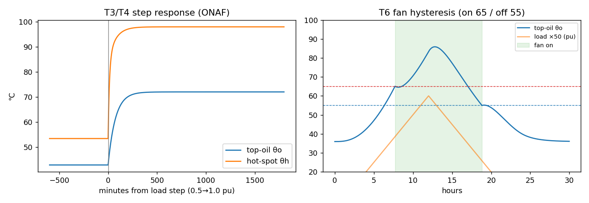
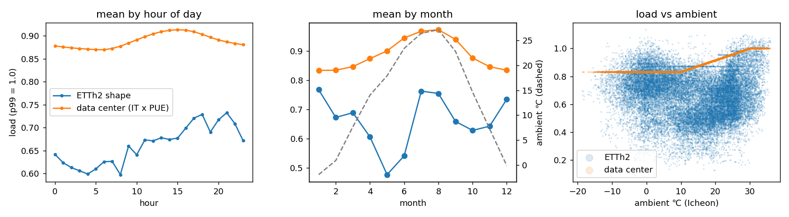

# 변압기 열적 노화·냉각 이상 진단

> **진행 중인 프로젝트다.** 현재 단계 0~2(데이터 준비, 열모델, 부하 곡선)까지 완료했다. 실험 1~3은 진행 예정이다.

## 질문

1. 변압기에 부하를 더 걸면 수명을 얼마나 더 쓰는가. 그 급증 지점은 설치 환경(옥외·옥내)과 계절에 따라 어떻게 움직이는가
2. 냉각팬이 고장 났을 때 무엇이 가장 먼저 알아채는가 — 고정 경보값, 규격 모델 잔차, 학습 모델 잔차
3. 변압기 부하율을 일정 수준(예: 50%) 이하로 운전하는 기준은 수명 때문인가, 이중화 때문인가

전력품질 이벤트 분류 프로젝트([fab_power_quality_classifier](https://github.com/taek0903/fab_power_quality_classifier))와 같은 원칙을 따른다.
**규격 모델로 비교 기준을 먼저 세우고, 학습 모델은 그보다 나을 때만 쓴다.**

## 가설

실험 전에 세운 가설과 기각 조건이다. 결과가 나오면 판정 칸을 채우고, 기각된 가설도 지우지 않는다.
⚠ 표시는 예비 계산을 본 뒤에 세운 가설이다.

| # | 가설 | 근거 | 기각 조건 | 판정 |
|---|---|---|---|---|
| H1-1 | 이천 연평균 기온(약 13℃)은 규격 기준(20℃)보다 낮지만, 여름 고온 때문에 연간 수명 소모가 정격 1년치(8,760시간)에 도달하는 부하율은 1.0보다 낮다 | 노화율은 온도에 지수적이라 짧은 고온 구간이 평균을 지배한다 | 그 부하율이 1.0 이상 | 미검증 |
| H1-4 | 환기만 하는 옥내는 옥외보다 수명 소모 급증 지점이 낮은 부하율로 당겨진다 | 손실열이 실내에 갇혀 주위온도를 다시 올린다 | 급증 지점이 옥외와 같거나 더 높음 | 미검증 |
| H2-2 | 파라미터 오차가 없으면 규격 잔차(B)가 고정 경보(A)보다 빨리 잡고 오경보도 적다 | 외기·부하로 설명되는 상승분을 빼고 본다 | B가 A보다 느리거나 오경보가 많음 | 미검증 |
| H2-3 | 감시 모델의 파라미터 오차가 커지면 B가 무너지고, 어느 지점에서 학습 잔차(C)가 B를 앞선다 | C는 명판값 없이 데이터에서 관계를 배운다 | 오차 범위 전체에서 B가 C보다 낫거나, 처음부터 C가 앞섬 | 미검증 |
| H2-4 | 팬이 원래 돌지 않는 저부하 시기의 팬 고장은 어떤 방식으로도 온도로 검출되지 않는다 | 팬이 꺼져 있을 시간에는 고장이 온도에 흔적을 남기지 않는다 | 저부하 고장을 어느 방식이든 검출함 | 미검증 |
| H3-2 | 한 대가 빠지는 사고에서 수명 소모가 급증하는 경계는 n대 운전 시 (n−1)/n 부근이다 (2대 50%, 3대 약 67%) | 남은 변압기가 떠안는 몫 | 경계가 대수와 무관하거나 (n−1)/n과 크게 다름 | 미검증 ⚠ |

보조 가설 9개(계절 집중, 연도 차이, 공조 옥내, 학습 모델의 외삽, 효율 등)는 핵심 가설 검증과 함께 확인한다.

## 데이터 구성

| 요소 | 출처 | 실측 여부 |
|---|---|---|
| 외기온도 | 기상청 ASOS 이천(203) 시간자료, 2023~2025 | 실측 |
| 부하 곡선 ① | ETT 데이터셋 ETTh2 `HUFL`의 모양 | 실측 (모양만) |
| 부하 곡선 ② | 데이터센터형: IT 부하 일정 × PUE(외기) | 모델 |
| 유온·최고점 온도 | IEC 60076-7 열모델 | 규격 모델 |

### 실측 변압기 데이터를 쓰지 않은 이유

ETT 데이터셋에는 변압기 유온이 들어 있지만 먼저 열어본 결과 그대로 쓸 수 없었다.

- 유온이 부하가 아니라 외기·일사를 따라간다 (ETTh1 유온–부하 상관 0.06, 유온 최고 시각 15시)
- 외기온도와 정격용량이 없어 규격 열모델의 입력(주위온도, 부하율)을 만들 수 없다
- 최고 유온이 46~59℃라 노화율 기준점(최고점 98℃)과 멀다

그래서 **외기와 부하는 실측을 쓰고, 온도 응답은 규격 모델로 계산**하는 구성으로 바꿨다.

## 열모델

IEC 60076-7(국내 KS C IEC 60076-7, IDT)의 차분방정식을 구현했다.

```
최상부 유온:  dθo/dt = [((1+K²R)/(1+R))^x · Δθor − (θo − θa)] / (k11·τo)
최고점 상승:  dΔθh1/dt = [k21·K^y·Δθhr − Δθh1] / (k22·τw)
             dΔθh2/dt = [(k21−1)·K^y·Δθhr − Δθh2] / (τo/k22)
             θh = θo + Δθh1 − Δθh2
노화율:      V = 2^((θh − 98)/6)      (일반 크라프트지)
```

- 냉각팬은 유온 기준으로 자동 운전한다(켜짐·꺼짐 온도 사이에 간격을 둠). 팬이 꺼지면 ONAN 파라미터와 ONAN 정격 기준 부하율로 바뀐다
- 계산 간격은 1분이다. 입력은 1시간 단위지만 권선 시정수(7~10분) 때문에 잘게 나눴다

### 파라미터 근거

| 항목 | 값 | 근거 |
|---|---|---|
| x, y | 0.8, 1.3 | IEC 60076-7:2005 공식 미리보기, Alliander 구현체 |
| τo, τw (ONAN / ONAF) | 210·10 / 150·7분 | Alliander 구현체 기본값과 일치 |
| k11, k21, k22 | 0.5, 2, 2 | Alliander 구현체 기본값과 일치 |
| Δθor, Δθhr, R | 52K, 26K, 6 | **변압기별 시험값.** 정격 시 최고점 98℃가 되는 가상의 변압기로 설정 |
| 정격, 팬 온도 | 60MVA, ONAN비 0.75, 65/55℃ | **가정값** |

규격 원문은 대조하지 못했다. 교차 확인한 범위와 가정값은 `config.yaml`에 항목별로 적어 두었다.

## 검증 (`verify_step1.py`)

| 검증 | 결과 |
|---|---|
| 정격 부하·외기 20℃ 정상상태 (ONAF) | 유온 72.00℃, 최고점 98.00℃, 노화율 1.000 |
| 팬 없이 ONAN 정격 부하 | 최고점 98.00℃ |
| 부하 계단 변화 후 유온 63% 도달 | 75분 (k11·τo = 75분) |
| 부하 급증 시 최고점–유온 온도차 | 최종값보다 7.4K 넘쳤다가 수렴 (k21 > 1인 규격 모델의 특징) |
| 계산 간격 1분 vs 0.5분 | 최고점 최대 차이 0.22K |
| 팬 자동 운전 | 65.1℃에서 켜짐, 55.0℃에서 꺼짐, 반복 없음 |
| 실측 외기 3년 계산 | 158만 스텝 약 2초 |



## 부하 곡선 (`load_profile.py`)



- 두 곡선 모두 상위 1% 값을 1.0으로 정규화했다. 실험에서 이 값에 목표 부하율을 곱한다
- ETTh2의 이상 구간 114시간(0 이하 값, 2017-04-17~19 급증 구간)은 7일 전 같은 시각 값으로 대체했다
- ETTh2는 외기와 V자 관계라(난방·냉방) 상관계수는 −0.07로 상쇄된다. 데이터센터형은 냉각 부하 때문에 0.93이다

## 실행

### 1. 데이터 받기 (저장소에 포함하지 않음)

- **기상청 ASOS**: [기상자료개방포털](https://data.kma.go.kr) → 종관기상관측(ASOS) → 시간 자료 → 지점 이천(203) → 요소 기온.
  기상청은 하루를 01~24시로 세므로 **종료일을 다음 해 1월 1일로** 잡아야 12월 31일이 빠지지 않는다. `data/`에 원본 CSV를 둔다
- **ETTh2**: [zhouhaoyi/ETDataset](https://github.com/zhouhaoyi/ETDataset)의 `ETT-small/ETTh2.csv`를 `data/ETTh2.csv`로 둔다

### 2. 순서

```bash
pip install -r requirements.txt
python prepare_weather.py   # 외기 병합·보간 → data/ambient_icheon_2023_2025.csv
python verify_step1.py      # 열모델 검증 → figs/step1_verify.png
python load_profile.py      # 부하 곡선 → data/load_profiles.csv
python plot_step2.py        # → figs/step2_load_profiles.png
```

## 파일

| 파일 | 역할 |
|---|---|
| `config.yaml` | 결정값과 근거 전부. 코드에 숫자를 흩어두지 않는다 |
| `prepare_weather.py` | 기상청 원본 병합, 결측 보간(연속 3시간 이상이면 중단) |
| `thermal_model.py` | IEC 60076-7 열모델 + 팬 운전 |
| `aging.py` | 노화율, 누적 수명 소모 |
| `load_profile.py` | 부하 곡선 두 종류 |
| `verify_step1.py`, `plot_step2.py` | 검증, 그림 |

## 한계

1. 유온·최고점은 실측이 아니라 규격 모델 출력이다
2. 온도 상승값·손실비는 가상의 변압기 값이다. 실제 변압기는 명판값과 다르게 거동한다
3. 노화 라벨이 없다. 수명 소모는 규격식이 말하는 값이지 검증된 잔여 수명이 아니다
4. 일사·풍속을 넣지 않았다. 옥외 여름 결과는 실제보다 낙관적일 수 있다
5. 유중가스분석·부분방전 같은 정밀 진단을 대신하지 않는다. 상시 계측되는 온도로 하는 1차 선별이다

## 진행 예정

- 옥외·옥내(환기 / 공조) 주위온도 모델
- 실험 1: 부하율–수명 소모 곡선 (환경·연도별)
- 실험 2: 냉각팬 고장 검출 비교 (고정 경보 / 규격 잔차 / 학습 잔차)
- 실험 3: 운전 대수·이중화 조건별 부하율 상한

## 데이터 출처

- 기상청 기상자료개방포털, 종관기상관측(ASOS) 이천(203) 시간자료
- Zhou et al., ETDataset (Electricity Transformer Temperature), https://github.com/zhouhaoyi/ETDataset
- 파라미터 교차 확인: Alliander, transformer-thermal-model (MPL-2.0), https://github.com/alliander-opensource/transformer-thermal-model
